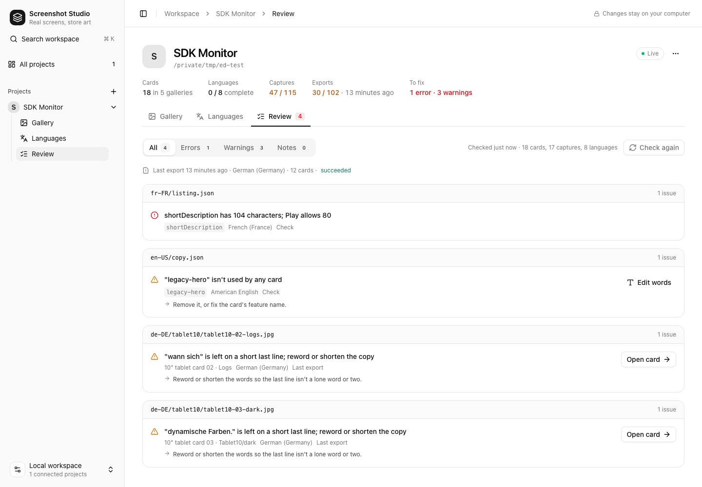
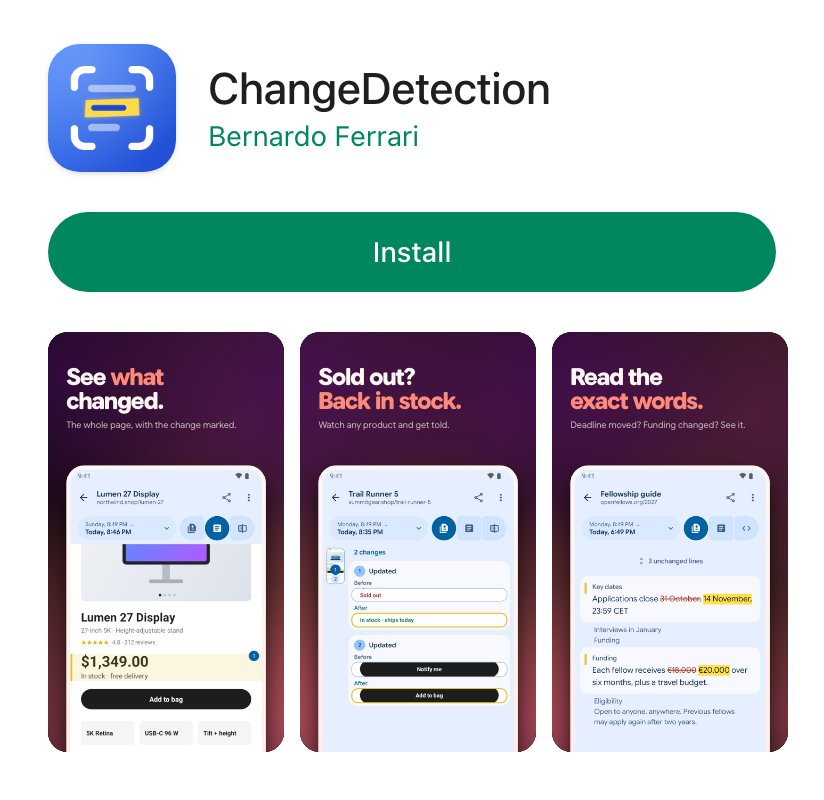

<p align="center">
  
</p>

<p align="center"><strong>Real app screens in. Store and README art out.</strong></p>

<p align="center">Screenshot Studio turns real screenshots of your app into Google Play and App Store screenshots, README images and app icons, in every language. It checks every card the way a reviewer would, and it's built so Claude and other agents can do the whole job for you.</p>

## Try it in a minute

Got screenshots? That's all you need.

```sh
npx screenshot-studio init --name "My App" --screenshots ./screenshots --theme aurora
npx screenshot-studio export
```

Your Play set is in `store-listing/en-US/`, phone and tablet screenshots sorted by shape. Then write your headlines in `store-listing/en-US/copy.json`, pick a look, and run `export` again. Or open the editor with `npx screenshot-studio studio --open`.

## Or ask Claude

```sh
claude mcp add screenshot-studio -- npx screenshot-studio mcp
```

Then: *"Make a Play Store screenshot set for this app from the screenshots in ./shots."* `init` installs a skill that teaches the agent the craft (benefit headlines, large real screens, one system across the set), and the MCP server lets it check its work and **look at every card it renders** before calling it done. [More on agents](docs/agents.md).

## Live as it changes

<p align="center">
  
</p>

The editor follows your files. When you (or an agent) save `theme.css`, the cards re-render in place. Click a card to inspect and reword it, see the set at Play's thumbnail size, and work through one **Review** list of everything left to fix.

<p align="center">
  
  
</p>

## Six looks to start from

Every theme recolors from three variables (`--paper`, `--ink`, `--accent`). `npx screenshot-studio themes` lists them.

<p align="center">
  
</p>

## Checked like a reviewer would

`check` validates every file in a second and says how to fix each problem. `export` renders each card and fails or warns on what you'd otherwise catch by eye:

- copy that doesn't fit, or leaves a lone word on its last line;
- a device cut off where it shouldn't be;
- a background that breaks between cards in the store carousel;
- captures that aren't a real device shape;
- store text over Play's limits, starter placeholders left in, languages still borrowing English.

## All the way to automatic

When the app changes, one command rebuilds everything: `npx screenshot-studio recapture --boot` builds your capture app, boots the Android emulator or iOS simulator, walks through your screens in every language (a clean 9:41 status bar, the right screen size for each device), and exports. [How capture works](docs/capture.md).

<p align="center">
  
</p>

The same studio makes the store listings and READMEs of [SDK Monitor](https://github.com/bernaferrari/SDKMonitor), Calcula, Keepout, QuietGuard, ChangeDetection, Wordkeep and WiFi Weakspot.

## Commands

| Command | Does |
|---|---|
| `init` | Set up an app: from screenshots (`--screenshots`), for capture (`--package`), Android or iOS (`--platform`), with a theme |
| `studio` | The editor |
| `check` | Check every file, fast; run it after each edit |
| `export` | Render and check every card (`--locale`, `--kind`, `--card`, `--strict`, `--fastlane`, `--prune`, `--json`) |
| `recapture` | Build, capture on the emulator or simulator, export (`--boot`) |
| `locales` | Language coverage; `--init de-DE` adds one |
| `icons` | Every app icon from one drawing |
| `mcp` | The MCP server for agents |
| `themes`, `sync` | List themes; update an app's copy of the studio |

## Documentation

| Guide | What's in it |
|---|---|
| [Playbook](docs/playbook.md) | From nothing to a finished listing: capture, design, export, ship |
| [Setting up an app](docs/setup.md) | The files an app keeps, cards and galleries, layouts, themes |
| [Themes](docs/themes.md) | The six starter looks and how to make your own |
| [Capturing](docs/capture.md) | Tours on the Android emulator and iOS simulator, one-command recapture |
| [Languages and export](docs/languages-and-export.md) | Words per language, the export's checks, fastlane |
| [Agents](docs/agents.md) | The skill and MCP server for Claude and other agents |
| [The editor](docs/editor.md) | Gallery, card inspector, store preview, languages, review |
| [App icons](docs/icons.md) | One drawing, every icon an app ships |
| [Development](docs/development.md) | Working on the studio itself |

## Principles

- **Real screens only.** No painted UI or made-up numbers; sample data is fictional and lives in a capture build.
- **Everything regenerates.** Words, layout and look are files in your repository; images are output.
- **Each app keeps its look.** The studio is shared; the theme is yours.
- **Each app builds on its own.** The studio is copied into the app, so an export never depends on a version you no longer have.

## License

[MIT](LICENSE)
