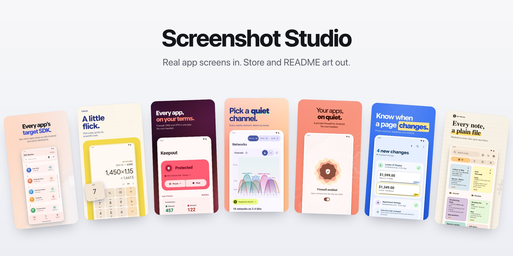
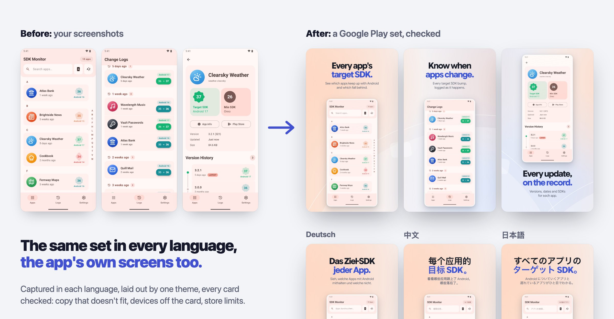
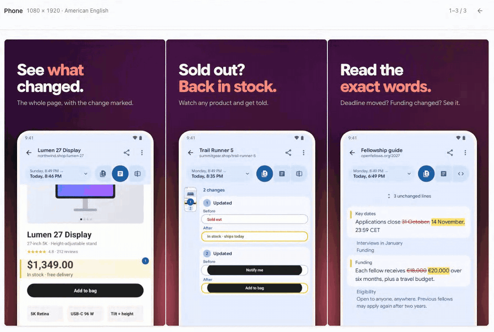
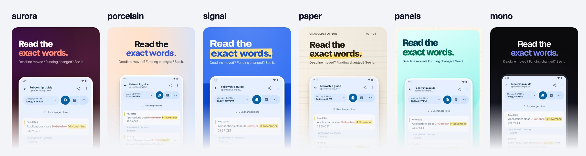
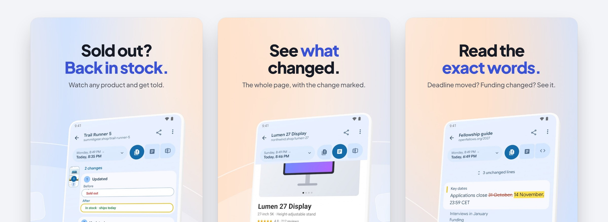
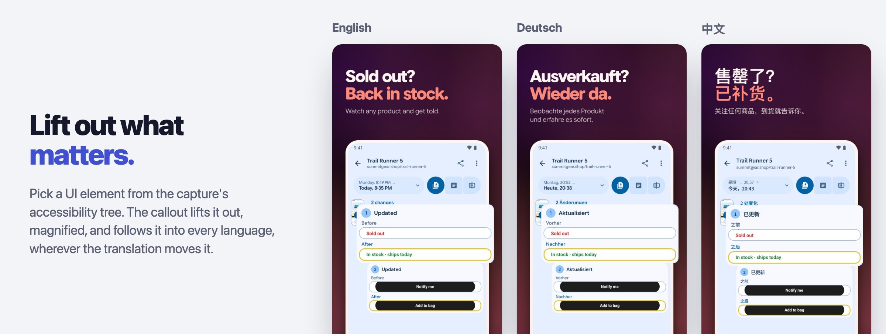
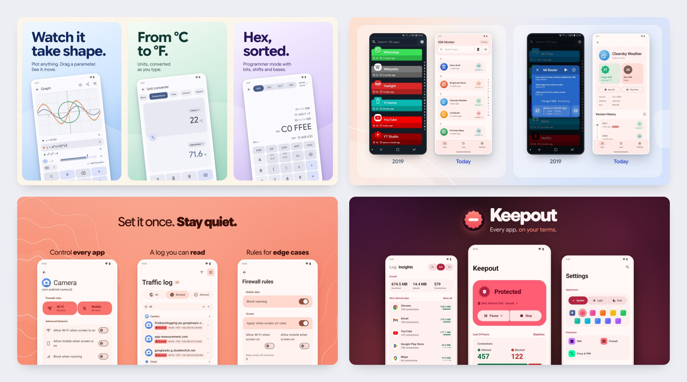

<p align="center">
  
</p>

<p align="center">Screenshot Studio turns real screenshots of your app into Google Play and App Store screenshots, README images and app icons, in every language. It checks every card the way a reviewer would, and it's built so Claude and other agents can do the whole job for you.</p>

<p align="center">
  
</p>

## Try it in a minute

No app needed: see a finished set made from real captures in three languages, then open it in the editor.

```sh
npx screenshot-studio demo
npx screenshot-studio demo --theme paper    # the same cards in another look
```

Got screenshots of your own app? That's all you need.

```sh
npx screenshot-studio init --name "My App" --screenshots ./screenshots --theme aurora
npx screenshot-studio export
```

Your Play set is in `store-listing/en-US/`, phone and tablet screenshots sorted by shape, plus the 1024 × 500 feature graphic Play asks for. Already use fastlane? Plain `npx screenshot-studio init` finds your screenshots and your app's name on its own. Then write your headlines in `store-listing/en-US/copy.json`, pick a look, and run `export` again. Or open the editor with `npx screenshot-studio studio --open`.

## Or ask Claude

```sh
claude mcp add screenshot-studio -- npx screenshot-studio mcp
```

Then: *"Make a Play Store screenshot set for this app from the screenshots in ./shots."* `init` installs a skill that teaches the agent the craft (benefit headlines, large real screens, one system across the set), and the MCP server lets it check its work and **look at every card it renders** before calling it done. [More on agents](docs/agents.md).

## Live as it changes

<p align="center">
  
</p>

The editor follows your files. When you (or an agent) save `theme.css`, the cards re-render in place. Click a card to inspect and reword it, see the set on a Google Play page at thumbnail size, track every language, and work through one **Review** list of everything left to fix.


## Six looks to start from

The same card in each of the six themes. Every theme recolors from three variables (`--paper`, `--ink`, `--accent`); try one on the demo with `npx screenshot-studio demo --theme paper`.

<p align="center">
  
</p>

## Real 3D phones

Turn on `depth` in a theme and every phone and tablet is drawn as a real 3D device, with its thickness, rounded edges and glass, posed by the frame's CSS. Add the `tilt` layout word to angle one. Try it: `npx screenshot-studio demo --3d`.

<p align="center">
  
</p>

## Zoom in on what matters

A callout lifts part of the real screen out and magnifies it. Pick it as a UI element from the capture's accessibility tree, not a box of pixels, and it follows that element into every language, wherever the translation moves it.

<p align="center">
  
</p>

## Checked like a reviewer would

`check` validates every file in a second and says how to fix each problem. `export` renders each card and fails or warns on what you'd otherwise catch by eye:

- copy that doesn't fit, or leaves a lone word on its last line;
- a device cut off where it shouldn't be;
- a background that breaks between cards in the store carousel;
- captures that aren't a real device shape;
- store text over Google Play's or the App Store's limits, starter placeholders left in, languages still borrowing English.

## Why not frameit, Figma or a screenshot website?

They're good at what they do; this does a different job.

- **fastlane frameit** puts a device frame and a title over a background. That's one look, and the rest is up to you. Screenshot Studio is the layout and the look too (themes, several devices per card, callouts, README art), and it writes fastlane's folders with `export --fastlane`, so it can sit right where frameit was.
- **A Figma template** gives you total freedom for one language. Eight cards in three sizes in twenty languages is 480 frames to keep in step by hand, and nothing tells you the German headline no longer fits. Here the words are one file per language and every card is re-rendered and checked from them.
- **A screenshot website** is quick for a first set. But your art lives in someone else's editor: it can't be regenerated when the app changes, reviewed in a pull request, or made by an agent. Here everything is files in your repository and images are output.

What only this does: the cards come from **real captures**, retaken by one command in every language, and `export` **checks** them like a reviewer before you ship.

## All the way to automatic

<p align="center">
  
</p>

The same studio makes the store listings and READMEs of [SDK Monitor](https://github.com/bernaferrari/SDKMonitor#readme), [Calcula](https://github.com/bernaferrari/calcula#readme), [Keepout](https://github.com/bernaferrari/keepout#readme), [QuietGuard](https://github.com/bernaferrari/QuietGuard#readme), [ChangeDetection](https://github.com/bernaferrari/ChangeDetection#readme), [Wordkeep](https://github.com/bernaferrari/wordkeep#readme) and [WiFi Weakspot](https://github.com/bernaferrari/wifi-weakspot#readme), the apps of [Kotlin Reforge](https://kotlin-reforge.vercel.app): old Android apps, rebuilt to feel new.

## Commands

| Command | Does |
|---|---|
| `demo` | A finished example from real captures, exported and opened in the editor (`--theme`, `--3d`) |
| `init` | Set up an app from screenshots, or for capture on Android or iOS, with a theme |
| `studio` | The editor |
| `check` | Check every file, fast; run it after each edit |
| `export` | Render and check every card; one language, gallery or card; fastlane folders |
| `recapture` | Build, capture on the emulator or simulator, and export |
| `screen` | What the capture emulator shows: a screenshot and every element to tap, for writing a tour |
| `locales` | Language coverage; `--init de-DE` adds one |
| `icons` | Every app icon from one drawing |
| `mcp` | The MCP server for agents |
| `themes`, `reset` | List themes; undo an interrupted capture |

Every command takes `--help` for its options.

## Documentation

| Guide | What's in it |
|---|---|
| [Playbook](docs/playbook.md) | From nothing to a finished listing: capture, design, export, ship |
| [Setting up an app](docs/setup.md) | The files an app keeps, cards and galleries, layouts, themes |
| [Themes](docs/themes.md) | The six starter looks and how to make your own |
| [Capturing](docs/capture.md) | Tours on the Android emulator and iOS simulator, one-command recapture |
| [Languages and export](docs/languages-and-export.md) | Words per language, the export's checks, fastlane |
| [Agents](docs/agents.md) | The skill and MCP server for Claude and other agents |
| [The editor](docs/editor.md) | Gallery, card inspector, store preview, languages, review |
| [App icons](docs/icons.md) | One drawing, every icon an app ships |
| [Development](docs/development.md) | Working on the studio itself |

## Principles

- **Real screens only.** No painted UI or made-up numbers; sample data is fictional and lives in a capture build.
- **Everything regenerates.** Words, layout and look are files in your repository; images are output.
- **Each app keeps its look.** The studio is shared; the theme is yours.
- **Nothing to vendor.** Apps keep only their words, look and captures; the studio comes from the package. Pin a version (`npx screenshot-studio@0.0.4`) if you like.

## License

[MIT](LICENSE)
