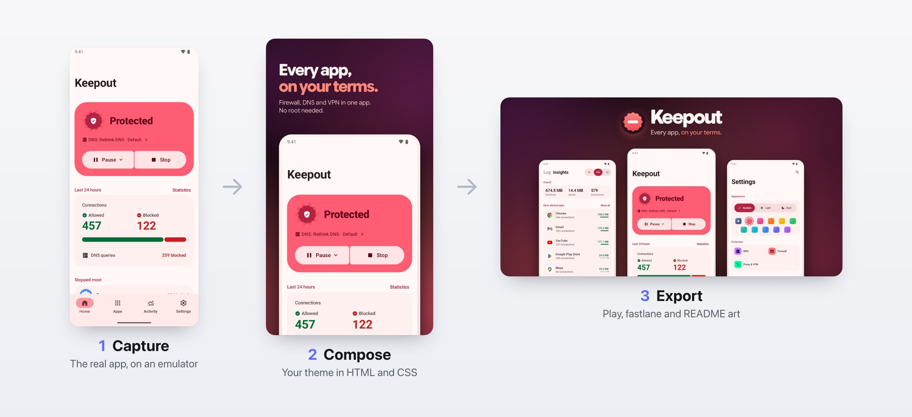
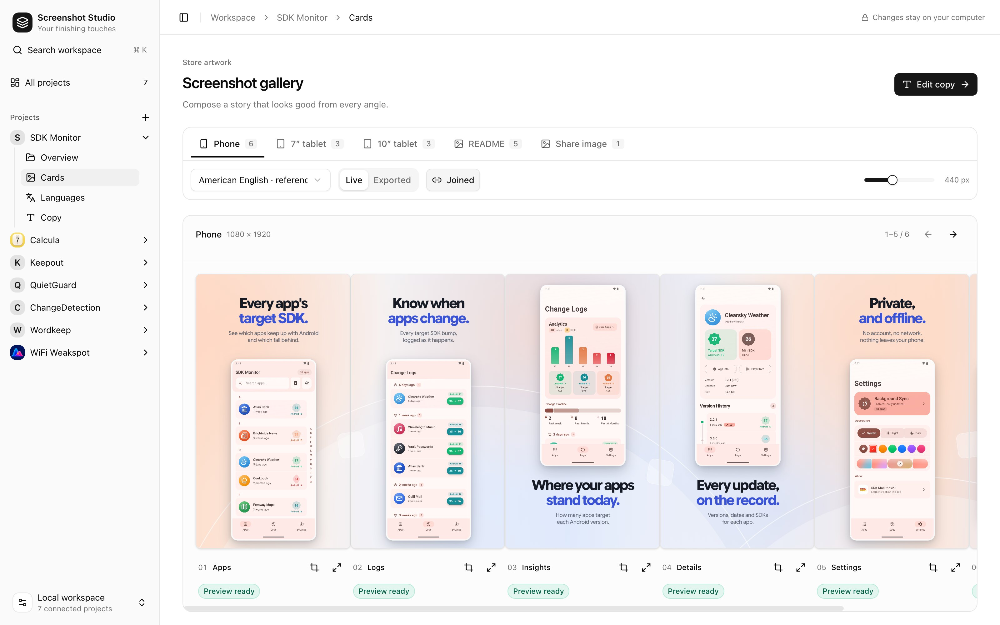

<p align="center">
  
</p>

<p align="center"><strong>Real app screens in. Store and README art out.</strong></p>

<p align="center">Screenshot Studio turns real captures of your Android app into Google Play screenshots for phones and tablets, README art and app icons. Every image is rebuilt from source by one command, in every language.</p>

## How it works

<p align="center">
  
</p>

1. **Capture.** A short Python tour drives your app on an emulator: tap here, scroll there, take a shot. The studio handles the rest: a clean status bar at 9:41, the right screen size for phone and tablets, each language, and a layout map of every screen.
2. **Compose.** Each card is an HTML page. The studio places the real capture in a device frame; your `theme.css` and `theme.js` give it your app's look: type, colors, background art.
3. **Export.** One command renders every card in every language, checks it (copy that overflows, devices cut off, a background that breaks between cards), and writes Play screenshots, fastlane metadata and README images.

When the app changes, run it again: `recapture.cjs` builds the app, captures, and exports in one go.

## One workflow, every app's own look

The same studio makes the Play listings and READMEs of [SDK Monitor](https://github.com/bernaferrari/SDKMonitor), Calcula, Keepout, QuietGuard, ChangeDetection, Wordkeep and WiFi Weakspot. Themes decide the look; the studio does the frames, layout, languages and checks.

<p align="center">
  
</p>

## The editor

A local web app for every project you connect: browse each gallery live or as exported, edit copy side by side with the English reference, and pick callouts on the real screen.

<p align="center">
  
</p>

## Quick start

You need Node, Python 3 with [uv](https://docs.astral.sh/uv/), and the Android SDK with an emulator.

```sh
npm ci                                                       # once, here: installs Playwright
export PLAYWRIGHT_MODULE="$PWD/node_modules/playwright"      # so an app's scripts find it
node init.cjs /path/to/app --name "My App" --package com.example.app
```

Then, in the app:

```sh
node store-listing/studio/server.cjs 8790             # the editor, at http://127.0.0.1:8790/store-listing/studio/
node store-listing/studio/recapture.cjs               # build, capture and export everything
node store-listing/studio/export.cjs --locale en-US   # export only
```

`init.cjs` creates `store-listing/` with a starter theme, gallery and copy, and syncs the studio into it. The [playbook](docs/playbook.md) takes it from there to a finished listing.

## Documentation

| Guide | What's in it |
|---|---|
| [Playbook](docs/playbook.md) | From nothing to a finished Play listing and README: capture, design, export, ship |
| [Setting up an app](docs/setup.md) | The files an app keeps, cards and galleries, layouts, themes |
| [Capturing](docs/capture.md) | The scene tour, the emulator, and the one-command recapture |
| [Languages and export](docs/languages-and-export.md) | Copy per language, the exporter's checks, fastlane |
| [App icons](docs/icons.md) | One drawing, every icon an app ships |
| [The editor](docs/editor.md) | Projects, cards, languages, copy and callouts |
| [Development](docs/development.md) | Working on the studio itself: the UI, syncing into apps, tests |

## Principles

- **Real screens only.** Captures come from the running app with Android's own status bar; no painted UI, no made-up numbers. Sample data is fictional and lives in a capture build.
- **Everything regenerates.** Words, layout and look are files in the app's repository; images are output.
- **Each app keeps its look.** The studio is shared; the theme is the app's.
- **Each app builds on its own.** The studio is copied into every app (`./sync.sh`), so no app depends on this repository to export.
