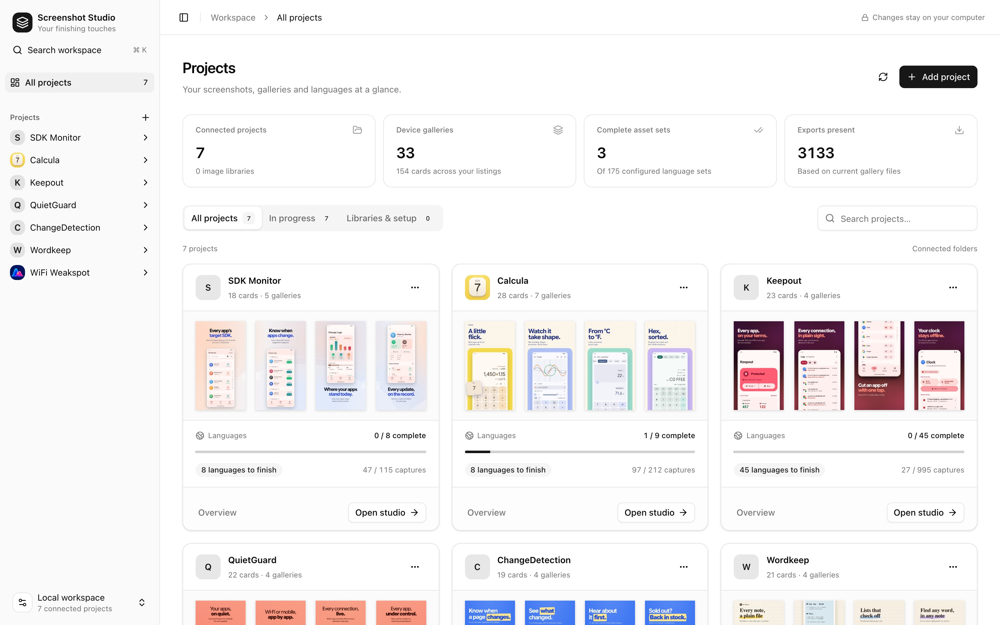
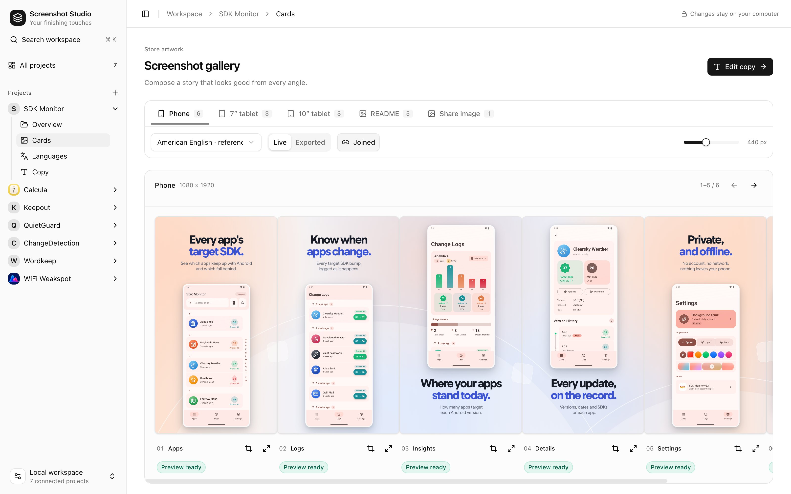

# The editor

A local web app for every project you connect.

```sh
node studio/server.cjs 8790                      # from this repository: the whole workspace
node store-listing/studio/server.cjs 8790        # from an app: that app, connected automatically
```

Open `http://127.0.0.1:8790/studio/` (or `/store-listing/studio/` inside an app). Nothing leaves your computer.

<p align="center">
  
</p>

## Projects

**All projects** shows every connected project with its cards, language progress and capture coverage. Each project has **Overview**, **Cards**, **Languages** and **Copy**.

**Add project** takes an app folder (or a folder of screenshots, which becomes an image library) by path or with the folder chooser on macOS. **Find projects** searches a parent folder and lets you pick what to connect. Removing a project only forgets it; its files stay.

The project list lives in `~/.screenshot-studio/projects.json`, shared by every studio server. Use `--registry /path/projects.json` (or `SCREENSHOT_STUDIO_PROJECTS`) for a separate list, and `--add /path/to/app` to connect folders from the command line.

A language's **complete asset set** means its copy is filled in and its captures, layout maps and exports are all present. It doesn't mean they're fresh or pass a strict export.

## Cards

<p align="center">
  
</p>

One gallery in one language, live from the source files or as exported. **Joined** shows the cards edge to edge, as the store carousel does. Zoom and paging don't reload the artwork.

**Callouts.** Pick a callout by dragging over the reference capture, or switch to **Element** to pick a UI element from the capture's layout map: hover or search by text, label, resource ID or path, and **Parent element** to widen the pick. An element callout snaps to the element's exact bounds and follows it into every language; a missing or ambiguous element is flagged and fails a strict export. Set magnification and corner radius, type exact coordinates, copy the JSON, or save it to `gallery.json`. Check localized callouts by eye even when they matched.

## Languages

Every language with its coverage, filterable to **Needs copy** or **Copy complete**. Expand a row to preview that language's gallery; **Continue translation** opens the first unfinished one.

## Copy

The reference words beside editable fields, with character counts and a visible note wherever a field falls back to English. Search by card or phrase, or filter to missing fields. **Save copy** (or Cmd/Ctrl+Enter) writes that language's `copy.json` and refreshes the preview. Unsaved words are kept in the browser tab across views, projects and reloads; if the file changed elsewhere, you choose which to keep.

## Shortcuts

| Keys | Does |
|---|---|
| Cmd/Ctrl+K | Search projects |
| Cmd/Ctrl+B | Toggle the sidebar |
| Cmd/Ctrl+Enter | Save copy |
| ← → , Home, End | Move through the image viewer |
| 0, double-click, pinch | Fit or zoom in the image viewer |
| Esc | Close the viewer |
